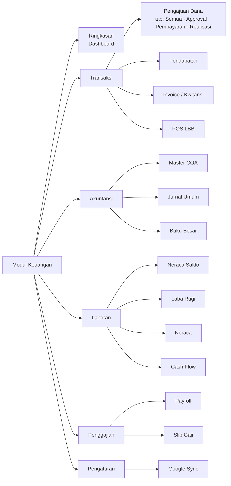
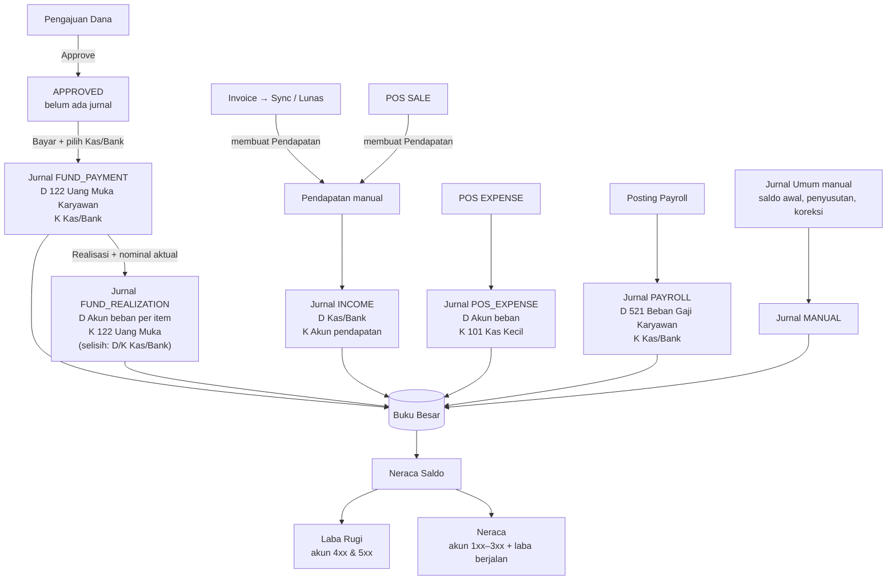

# Flow Integrasi COA & Akuntansi — Modul Keuangan

Sumber: `Sistem Akuntansi Terintegrasi COA.pdf` dan `Daftar_Kode Akun_COA.pdf`.

## 1. Prinsip

1. **Satu COA untuk semua perusahaan**; setiap jurnal punya kolom `company` sehingga semua laporan bisa difilter per perusahaan (BCI, MKTECH, MNT, DPI, LBB, PIC, …) atau gabungan.
2. **Double-entry**: setiap transaksi uang menghasilkan 1 jurnal dengan total Debit = total Kredit. Jurnal tidak seimbang ditolak.
3. **Transaksi operasional tetap seperti sekarang** (pengajuan dana, pendapatan, invoice, POS, payroll). Jurnal dibuat **otomatis** di belakangnya — user operasional cukup memilih akun di form.
4. **Satu sumber = satu jurnal** (`sourceType + sourceId` unik). Edit sumber → jurnal diperbarui; hapus sumber → jurnal ikut terhapus. Jurnal otomatis terkunci (tidak bisa diedit manual).
5. **Akun induk** (100, 130, 160, 200, 250, 300, 400, 450, 500, 520, 540, 570) hanya untuk pengelompokan, tidak bisa dipakai di jurnal.
6. Laporan **Cash Flow & Google Sync lama tetap jalan** apa adanya; laporan akuntansi baru dihitung dari jurnal.

## 2. Struktur menu baru

URL lama (`/keuangan/persetujuan`, `/pembayaran`, `/realisasi`) diarahkan ke tab yang sesuai.

## 3. Alur jurnal otomatis

### Aturan anti dobel

| Sumber | Dijurnal dari | Catatan |
|---|---|---|
| Invoice | **Pendapatan** hasil sync | Invoice sendiri tidak dijurnal |
| POS SALE | **Pendapatan** sumber POS | PosTransaction SALE tidak dijurnal |
| POS EXPENSE | PosTransaction | — |
| Pengajuan dana | Saat **dibayar** (kas keluar) dan saat **direalisasi** (uang muka → beban) | Dua jurnal berbeda, saling menutup akun 122 |
| Payroll | PayrollPosting | Re-posting periode yang sama memperbarui jurnal, bukan menambah |

## 4. Akun default (bisa diganti di form)

| Transaksi | Debit | Kredit |
|---|---|---|
| Pembayaran pengajuan | 122 Uang Muka Karyawan | 102 Kas Operasional |
| Realisasi pengajuan (per item) | 569 Beban Administrasi Lainnya | 122 Uang Muka Karyawan |
| Pendapatan manual / invoice | 102 Kas Operasional | 403 Pendapatan Jasa |
| Pendapatan POS | 101 Kas Kecil | 420 Pendapatan Penjualan Offline |
| Pengeluaran POS | 569 Beban Administrasi Lainnya | 101 Kas Kecil |
| Payroll | 521 Beban Gaji Karyawan | 102 Kas Operasional |

## 5. Perubahan form

- **Pengajuan dana (buat/edit):** tiap item punya pilihan **akun beban** (5xx, default 569).
- **Bayar:** tambah pilihan **dibayar dari** (Kas/Bank 101–108).
- **Realisasi:** tambah **nominal aktual** (default = total pengajuan). Selisih otomatis dijurnal ke Kas/Bank yang sama.
- **Pendapatan:** tambah **akun pendapatan** (4xx) dan **masuk ke** (Kas/Bank).
- **Invoice → Sync:** pilih akun pendapatan + Kas/Bank tujuan (default 403 & 102 Kas Operasional).
- **POS:** pilihan akun untuk pengeluaran; edit/hapus POS ikut memperbarui pendapatan & jurnalnya (sekarang belum).

## 6. Laporan

| Laporan | Isi | Filter |
|---|---|---|
| Buku Besar | Mutasi per akun + saldo berjalan | Akun, rentang tanggal, perusahaan |
| Neraca Saldo | Total debit, kredit, saldo per akun; cek seimbang | Rentang tanggal, perusahaan |
| Laba Rugi | Pendapatan − Beban, dikelompokkan per akun induk | Rentang tanggal, perusahaan |
| Neraca | Aset = Kewajiban + Ekuitas (+ laba tahun berjalan) | Per tanggal, perusahaan |

Preset rentang: **Periode 26–25** (sama dengan payroll/cash flow), bulan kalender, tahun berjalan. Semua laporan bisa diekspor ke XLSX.

## 7. Hak akses

| Role | Lihat laporan | Kelola COA & Jurnal Umum |
|---|---|---|
| SUPER_ADMIN, ADMIN, KEUANGAN | ✓ | ✓ |
| DIREKSI | ✓ | — |

Permission baru: `finance:accounting` (kelola COA & jurnal manual). Laporan memakai `finance:view`.

## 8. Data lama & saldo awal

1. Seed 279 akun COA dari PDF (sekali, idempoten).
2. Backfill jurnal otomatis untuk semua transaksi lama dengan akun default: pengajuan PAID/REALIZED, pendapatan, pengeluaran POS, payroll posting. Bisa dijalankan ulang tanpa dobel.
3. Saldo awal (kas, bank, modal, utang, aset tetap) diinput lewat **Jurnal Umum** dengan tipe "Saldo awal".

## 9. Perbaikan bug yang ikut dibereskan

- Laporan keuangan per perusahaan (asisten/MCP) menghitung penjualan POS dua kali.
- Edit/hapus transaksi POS tidak memperbarui pendapatan terkait.
- Posting payroll "ALL" dan per perusahaan di bulan yang sama bisa dobel.

## 10. Urutan pengerjaan

1. Schema: `Account`, `JournalEntry`, `JournalLine`; kolom akun di item pengajuan, pendapatan, POS; nominal aktual realisasi. Migrasi + seed COA.
2. `src/lib/accounting/*`: validasi jurnal, posting otomatis per sumber, perhitungan laporan.
3. Hook ke semua API transaksi + backfill script.
4. UI: Master COA, Jurnal Umum, Buku Besar, Neraca Saldo, Laba Rugi, Neraca.
5. Restruktur menu Keuangan + tab Pengajuan Dana.
6. Typecheck, build lokal, deploy (migrasi + seed + backfill otomatis di `vps-update.sh`).
